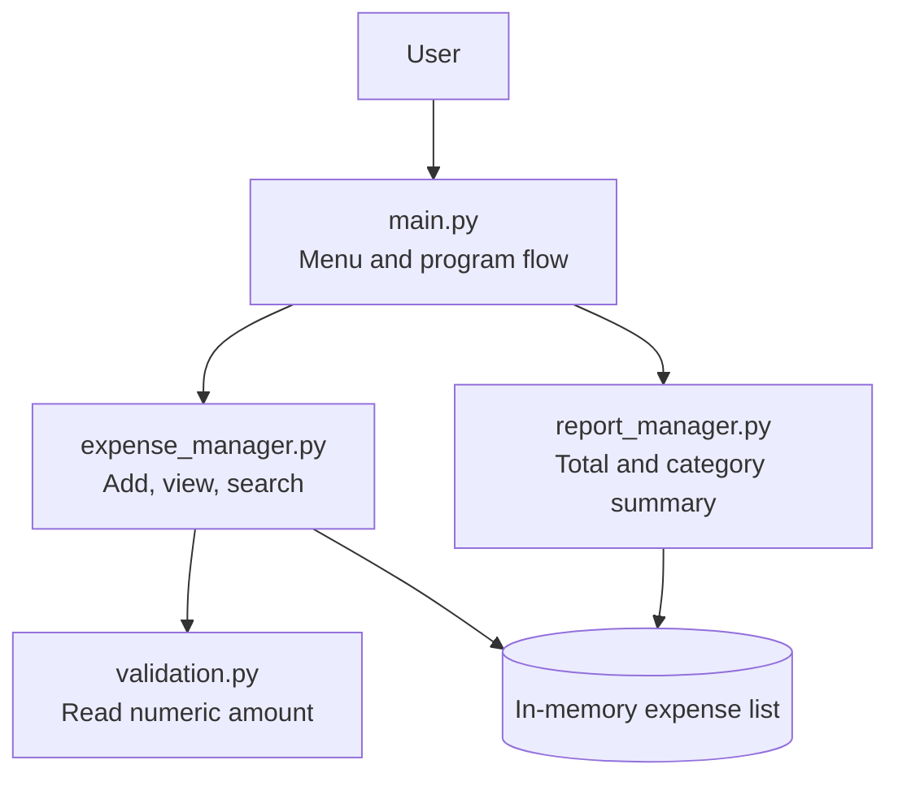
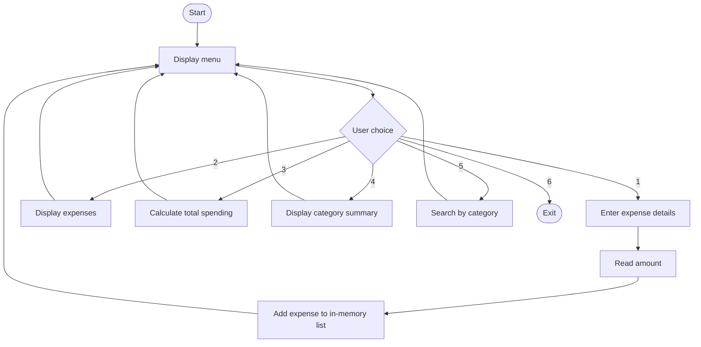
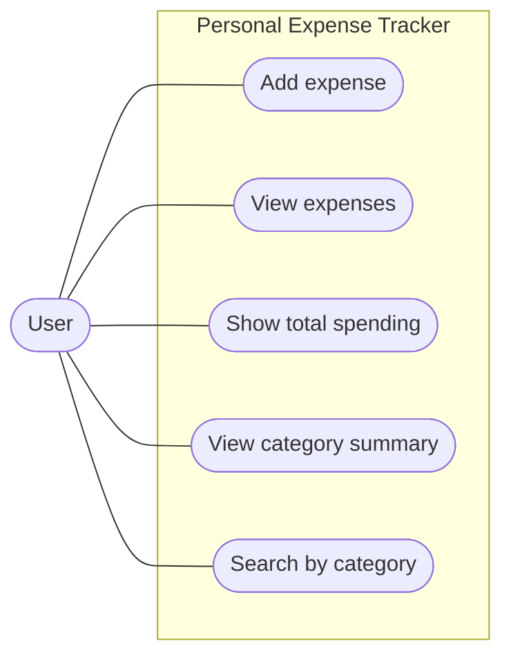
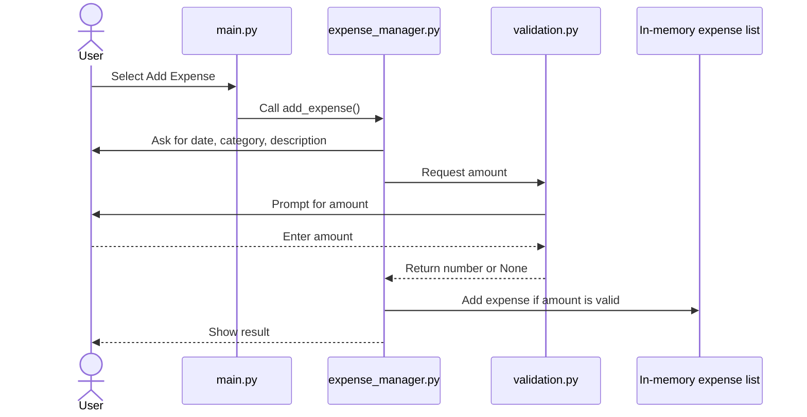
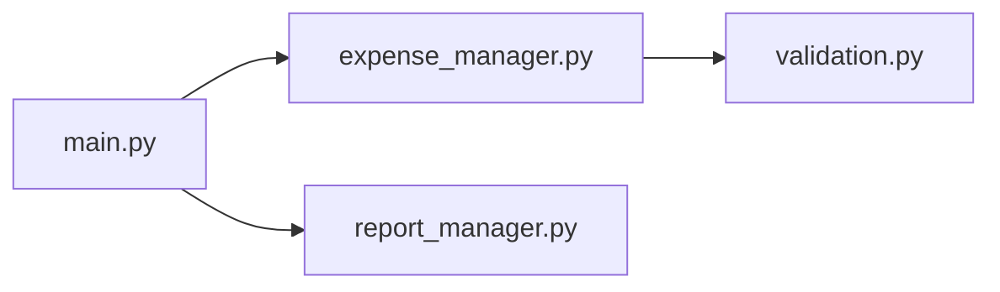

# Project Design

## 1. System Architecture

## 2. Workflow Diagram

## 3. Use-Case Diagram

## 4. Sequence Diagram: Adding an Expense

## 5. Component Diagram

## 6. Storage Design

Expenses are stored in memory in a Python list. Each expense is represented by a dictionary containing `date`, `category`, `description`, and `amount`. The records are cleared when the program exits. There is no database, so an ER diagram is not applicable.